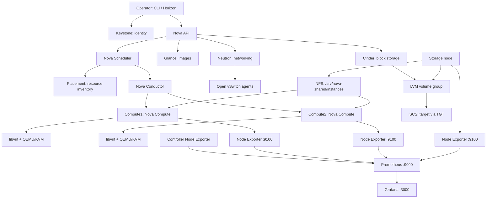
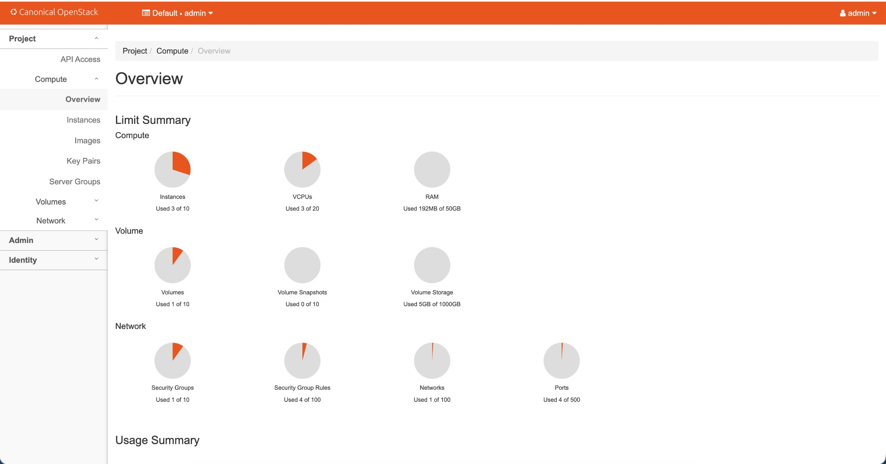
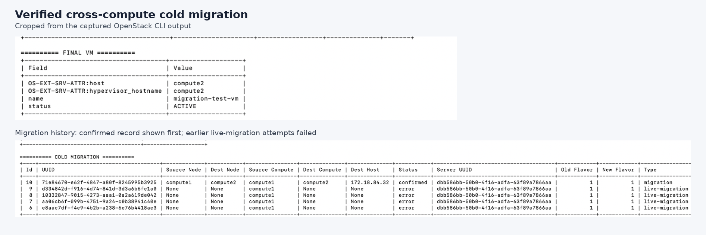
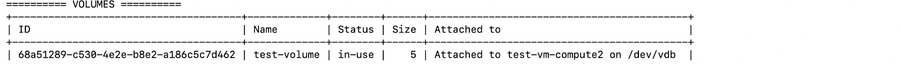

# OpenStack Multinode Lab: Compute, Storage, Networking & Monitoring

I built this lab to learn how the main parts of an Infrastructure-as-a-Service (IaaS) cloud fit together. Instead of documenting only installation commands, I captured the checks I used to validate compute, networking, storage, migration and monitoring.

This repository is a **hands-on lab write-up backed by screenshots and captured command results**. It is not a one-command installer, and it intentionally does not contain full server configuration files, credentials or raw terminal transcripts.

## At a glance

- **Four lab nodes:** one controller, two compute nodes and one storage node.
- **Compute:** Nova Compute with libvirt and QEMU/KVM on the compute nodes.
- **Networking:** Neutron with Open vSwitch agents.
- **Block storage:** Cinder backed by LVM and iSCSI/TGT on the storage node.
- **Shared instance directory:** NFS export mounted by both compute nodes.
- **Migration:** a cross-compute cold migration was confirmed; live-migration attempts remain an unresolved lab issue.
- **Monitoring:** Prometheus and Node Exporter on the four nodes, with a Grafana dashboard for node health, CPU, memory, disk and network activity.

## Lab topology

| Node | Private lab address | Main role |
|---|---:|---|
| `controller` | `172.18.84.22` | OpenStack control-plane services, Prometheus, Grafana, Node Exporter |
| `compute1` | `172.18.84.23` | Nova Compute, libvirt/QEMU-KVM, Neutron OVS agent, NFS client, Node Exporter |
| `compute2` | `172.18.84.32` | Nova Compute, libvirt/QEMU-KVM, Neutron OVS agent, NFS client, Node Exporter |
| `storage` | `172.18.84.33` | Cinder LVM/iSCSI backend, NFS export, Node Exporter |

These are private addresses from my lab, not public endpoints. The lab was hosted in a VMware ESXi environment; the OpenStack compute nodes used libvirt and QEMU/KVM for instances.

## Architecture

For a longer explanation of the flow and components, see [Architecture](docs/architecture.md).

## Evidence from my lab

The screenshots below are selected, reviewed captures from the lab. The [evidence index](evidence/README.md) explains what each image supports. The images are evidence of specific checks at the time they were captured; they do not imply that every service was healthy at every point in the troubleshooting process.

### Monitoring dashboard

The dashboard showed all four Node Exporter nodes as healthy (`1`) and displayed metrics for CPU, memory, disk and network traffic. Some chart legends in the captured view are still verbose; those are presentation improvements rather than missing metrics.

### OpenStack Horizon

This capture shows the Horizon project overview and its resource usage summary.

### Cross-compute cold migration

The captured result shows `migration-test-vm` as `ACTIVE` on `compute2` and the migration history record as `confirmed`. Earlier live-migration attempts failed; see [Troubleshooting](docs/troubleshooting.md).

### Cinder block volume

The `test-volume` record showed a size of 5 (GiB as reported by the OpenStack volume view), state `in-use`, and attachment to a VM on Compute2.

### Compute nodes, storage and monitoring checks

| Evidence | What the capture shows |
|---|---|
| [Compute1 validation](evidence/compute1-validation.png) | Node address, Nova/libvirt service checks, shared NFS mount, running instance and local Node Exporter check. |
| [Compute2 validation](evidence/compute2-validation.png) | Equivalent validation on Compute2, including shared storage and Node Exporter. |
| [Storage-node validation](evidence/storage-node-validation-redacted.png) | LVM/iSCSI target details, NFS exports for both compute nodes and Node Exporter. Sensitive account/ACL output was excluded from this prepared image. |
| [Prometheus and exporter checks](evidence/prometheus-exporter-checks.png) | Prometheus readiness and successful metrics checks for the four Node Exporter endpoints. |

## What worked, and what did not

| Area | Result supported by the captured evidence |
|---|---|
| OpenStack control plane and Horizon | Core services and the Horizon UI were configured. Service states varied across troubleshooting snapshots, so a current deployment should be checked before reuse. |
| Shared NFS instance directory | `172.18.84.33:/srv/nova-shared/instances` was mounted on both compute nodes, and a test file was visible through the shared mount. |
| Cinder block volume | The LVM volume group `cinder-volumes` was present. A 5 GiB test volume was reported as `in-use` and attached to a VM on Compute2. |
| Cold migration | Cross-compute migration from Compute1 to Compute2 was confirmed, and the VM was `ACTIVE` on Compute2. **Succeeded.** |
| Live migration | Attempts using `--live-migration` repeatedly returned a Nova `MigrationError_Remote` HTTP 500. The root cause was not conclusively isolated. **Not completed.** |
| Monitoring | Prometheus was ready, all four Node Exporter endpoints responded, Grafana successfully queried the Prometheus API, and the dashboard displayed data. |
| Grafana blank-page behavior | The dashboard sometimes rendered as a blank page in Chrome and later displayed correctly. I did not establish a definitive root cause, so I have documented it as an unresolved browser/frontend issue. |

## Repository guide

- [Architecture](docs/architecture.md) — how the OpenStack components fit together.
- [Deployment notes](docs/deployment-notes.md) — topology, storage layout and configuration decisions.
- [Validation and results](docs/validation-and-results.md) — evidence-backed checks and outcomes.
- [Monitoring](docs/monitoring.md) — Prometheus, Node Exporter, Grafana and PromQL queries.
- [Troubleshooting notes](docs/troubleshooting.md) — migration errors, service-state checks and the Grafana blank screen.
- [Interview preparation](docs/interview-prep.md) — a project explanation and questions based on this lab.
- [Command reference](docs/commands-cheatsheet.md) — command lookup by task.
- [Read-only command files](commands/README.md) — grouped shell diagnostics; they are not installers.
- [Curated command outputs](outputs/README.md) — short, sanitized result extracts, not raw logs.
- [Evidence index](evidence/README.md) — reference for every screenshot included here.
- [Prometheus example](examples/prometheus.yml) — a sample scrape configuration using this lab's private IPs.
- [GitHub upload guide](GITHUB_UPLOAD.md) and [security notes](SECURITY.md).

## Skills practised

OpenStack fundamentals, Linux administration, Nova, Keystone, Glance, Neutron, Placement, Cinder, Open vSwitch, libvirt/QEMU/KVM, LVM, iSCSI/TGT, NFS, Prometheus, Node Exporter, Grafana, PromQL, CLI validation, service logs and systematic troubleshooting.

## Reproducibility note

I no longer have access to the original lab servers. This repository documents the configuration decisions and test results I captured. Where a full config file or exact package version was not preserved, I have not guessed it. The examples are meant to explain and help recreate a similar lab; they are not a supported, production-ready installer.
