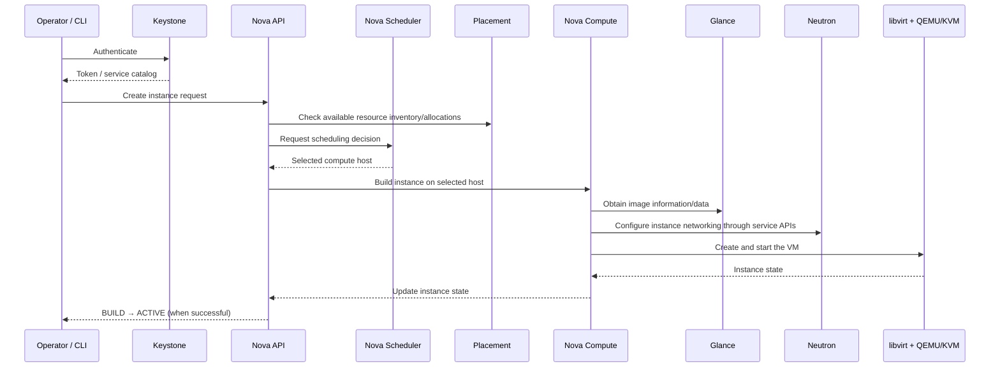
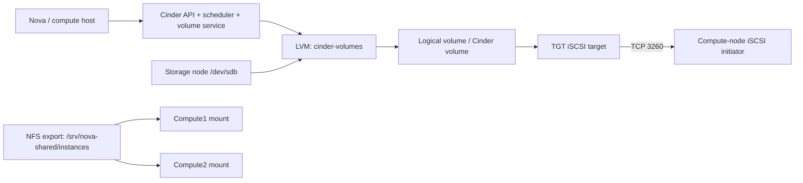
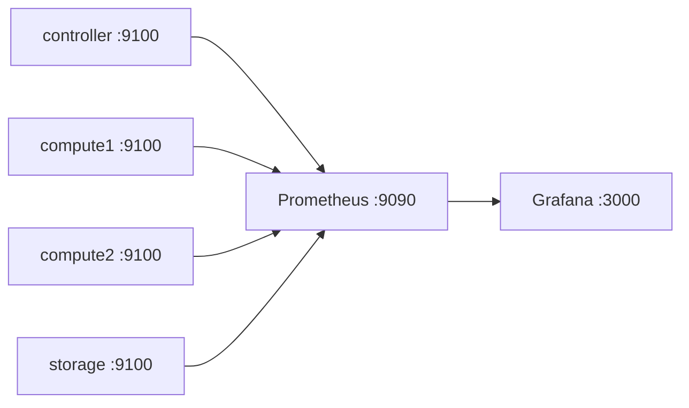

# Architecture and component map

The lab separates the control plane, compute and storage roles. It uses four Ubuntu nodes on a private lab network and a browser-based Horizon dashboard for the OpenStack UI.

## Node roles

| Node | Address | Role in the lab |
|---|---:|---|
| Controller | `172.18.84.22` | OpenStack API/control services; Prometheus; Grafana; Node Exporter |
| Compute1 | `172.18.84.23` | Nova Compute, libvirt/QEMU-KVM, Neutron OVS agent, NFS client, Node Exporter |
| Compute2 | `172.18.84.32` | Nova Compute, libvirt/QEMU-KVM, Neutron OVS agent, NFS client, Node Exporter |
| Storage | `172.18.84.33` | Cinder LVM/iSCSI backend, NFS server, Node Exporter |

## OpenStack services — the beginner's mental model

- **Keystone — identity:** authenticates users/services and issues tokens.
- **Glance — images:** stores VM image metadata and image data, such as CirrOS.
- **Nova — compute:** manages instance lifecycle and coordinates scheduling and compute-host work.
- **Nova Scheduler:** selects a candidate compute host based on requests, resource data and policy.
- **Placement — resources:** tracks resource-provider inventories and allocations used in scheduling decisions.
- **Nova Conductor:** coordinates Nova operations and isolates compute services from direct database access patterns.
- **Nova Compute:** runs on compute nodes and manages instances through the virtualization driver.
- **Neutron — networking:** creates networks, subnets, ports, routers and security-group behavior.
- **Open vSwitch (OVS):** supplies software switching on hosts where the Neutron OVS agent is running.
- **Cinder — block storage:** manages persistent block volumes and the configured storage backend.
- **Horizon — dashboard:** web UI for OpenStack APIs; it is not a replacement for the backend services.
- **MariaDB:** durable database state for OpenStack services.
- **RabbitMQ:** internal message broker used for RPC between cooperating service processes.

The precise placement of every API service can vary by deployment. This repository documents the roles confirmed in the captured lab rather than claiming a standardized production layout.

## VM creation flow

This diagram is intentionally conceptual. Real OpenStack operations involve additional RPC, database, Placement and Neutron calls.

## Storage architecture

The storage node's `/dev/sdb` (80 GB virtual disk in the lab) was used for the `cinder-volumes` LVM volume group. TGT exposed iSCSI storage; the compute node connected to the iSCSI target when the Cinder volume was attached. Separately, NFS shared the Nova instances directory between Compute1 and Compute2.

**Cinder and NFS solve different problems:** Cinder provides block volumes; NFS provides a shared filesystem. Shared storage helps migration scenarios but does not, by itself, make live migration work.

## Monitoring architecture

Node Exporter exposes host metrics, Prometheus scrapes them, and Grafana queries Prometheus to display dashboards. The lab dashboard included health, CPU, memory, disk and network panels.
