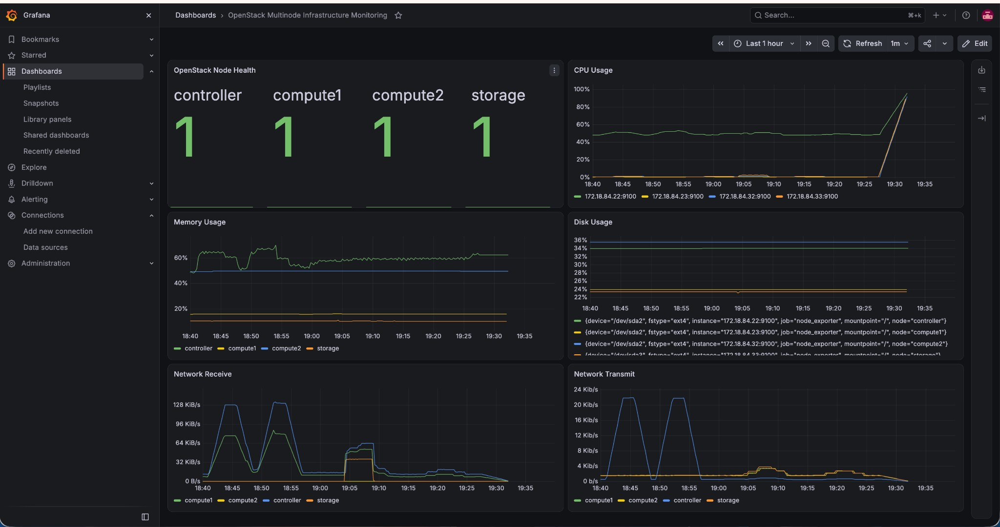

# Monitoring with Prometheus, Node Exporter and Grafana

I added monitoring after the core compute/storage tests so I could see the lab nodes' health and utilization from one place.

## Components and ports

| Component | Port | Purpose |
|---|---:|---|
| Prometheus | `9090` | Scrapes and stores time-series metrics |
| Node Exporter | `9100` on each node | Exposes Linux host metrics |
| Grafana | `3000` | Queries Prometheus and visualizes the metrics |

The four Node Exporter targets were:

- `172.18.84.22:9100` — controller
- `172.18.84.23:9100` — Compute1
- `172.18.84.32:9100` — Compute2
- `172.18.84.33:9100` — storage

The Prometheus self-target also appeared in the target list. A working endpoint is not the same as an all-time uptime guarantee; these are the checks captured from this lab session.

## Scrape configuration example

See [`examples/prometheus.yml`](../examples/prometheus.yml). It contains the lab's private target addresses and no credentials. Change addresses and labels for your own network before use.

## Grafana dashboard

The saved dashboard includes:

- **OpenStack Node Health** — `up{job="node_exporter"}`. A value of `1` means Prometheus can scrape that exporter; `0` means the scrape failed.
- **CPU Usage** — estimated non-idle CPU time as a percentage.
- **Memory Usage** — estimated used memory based on `MemAvailable` and `MemTotal`.
- **Disk Usage** — root filesystem usage, when filtered to `mountpoint="/"`.
- **Network Receive / Transmit** — rates of received and sent bytes excluding loopback.



## PromQL examples

### Node health

```promql
up{job="node_exporter"}
```

### CPU utilization percentage by node

```promql
100 - (
  avg by (node) (
    rate(node_cpu_seconds_total{job="node_exporter", mode="idle"}[5m])
  ) * 100
)
```

### Memory utilization percentage by node

```promql
100 * (
  1 -
  node_memory_MemAvailable_bytes{job="node_exporter"}
  /
  node_memory_MemTotal_bytes{job="node_exporter"}
)
```

### Root filesystem used percentage by node

```promql
100 * (
  1 -
  node_filesystem_avail_bytes{
    job="node_exporter", mountpoint="/", fstype!~"tmpfs|overlay"
  }
  /
  node_filesystem_size_bytes{
    job="node_exporter", mountpoint="/", fstype!~"tmpfs|overlay"
  }
)
```

### Network receive bytes per second

```promql
sum by (node) (
  rate(node_network_receive_bytes_total{job="node_exporter", device!="lo"}[5m])
)
```

### Network transmit bytes per second

```promql
sum by (node) (
  rate(node_network_transmit_bytes_total{job="node_exporter", device!="lo"}[5m])
)
```

The `node` legend assumes the corresponding target label is configured. Some of my captured panels still used instance labels or verbose filesystem labels; the queries above are cleaner examples for a future revision.

## Browser stability note

During the lab, the dashboard occasionally became a blank page in Chrome even though it later loaded and displayed data. The saved evidence proves the dashboard worked at capture time, but it does **not** prove the intermittent blank-page problem was permanently fixed. I reduced the time range to one hour and the refresh interval to one minute. The exact root cause remained unknown.
